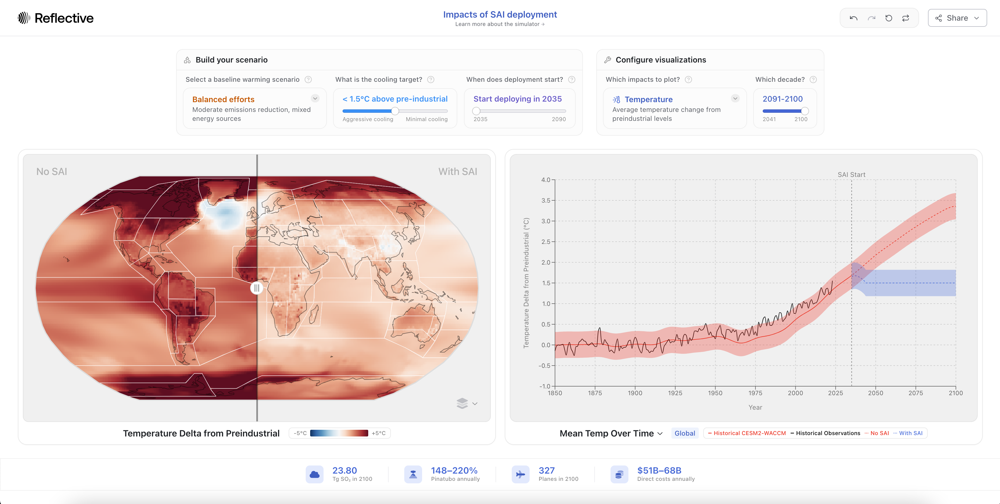

# sai-simulator

[](https://doi.org/10.5281/zenodo.15531372)

Official repository for [the SAI Simulator](https://simulator.reflective.org/), a new tool to explore the effects of stratospheric aerosol injection on the climate.



## Table of Contents

- [Introduction](#introduction)
- [Climate Model Data](#climate-model-data)
- [Setup Options](#setup-options)
- [Option 1: Automated Setup (Recommended)](#-option-1-automated-setup-recommended)
- [Option 2: Manual Setup](#-option-2-manual-setup)
  - [Environment Setup](#a-environment-setup)
  - [Data Download](#b-data-download)
  - [Data Processing](#c-data-processing)
  - [Fit the Regression Models](#d-fit-the-regression-models)
  - [Variability Calculation](#e-variability-calculation)
  - [Cache the Data](#f-cache-the-data)
  - [Launch Gradio](#g-launch-gradio)
- [Adding a New Model](#-adding-a-new-model)
- [License](#-license)
- [Citation](#%EF%B8%8F-citation)

## Introduction

The SAI Simulator is a web-based tool that runs in your browser at [simulator.reflective.org](https://simulator.reflective.org/). If you would like to reproduce the steps to prepare the data presented in the simulator, you can follow the instructions below.

## Climate Model Data

The simulator is trained on monthly output from two Earth system models, combined as an
equal-weight multi-model mean of **patterns per kelvin**: each model's regional fields
are regressed on **its own global-mean tas anomaly** (vs its own 1850–1900 mean), and at
request time FaIR's global anomaly (AR6 calibrated-constrained ensemble mean by default;
see `FAIR_CALIBRATION` in `backend/baseline.py`) is fed through every model's fitted
line and the lines are averaged 50/50 — that average is the final mapping from global
temperature to grid-cell values, so both patterns count equally even though the models'
transient sensitivities differ. One Zarr store per (model, experiment) is served from
the public bucket configured in `version.py` (`ZARR_STORES_URI`); the table lists what
each store contains.

| Model | Experiment | Members | Years | Data coverage | Native grid (lat × lon) |
|-------|------------|---------|-------|---------------|--------------------------|
| CESM2-WACCM-MA | historical | 3 (`001`–`003`) | 165 | 1850–2014 | 192 × 288 (~0.9° × 1.25°, fv09) |
| CESM2-WACCM-MA | baseline (SSP2-4.5) | 3 | 85 | 2015–2099 | 192 × 288 |
| CESM2-WACCM-MA | 1.5K-SAI (GAUSS) | 3 | 35 | 2035–2069 | 192 × 288 |
| CESM2-WACCM-MA | 1.0K-SAI (GAUSS) | 3 | 35 | 2035–2069 | 192 × 288 |
| CESM2-WACCM-MA | 0.5K-SAI (GAUSS) | 3 | 36 | 2035–2070 | 192 × 288 |
| MIROC-ES2H | historical | 3 (`r01`–`r03`) | 165 | 1850–2014 | 128 × 256 (T85, ~1.4°) |
| MIROC-ES2H | baseline (GeoMIP no-SAI reference, SSP2-4.5 forcing) | 3 | 65 | 2020–2084 | 128 × 256 |
| MIROC-ES2H | ssp245 (ScenarioMIP SSP2-4.5) | 3 | 86 | 2015–2100 | 128 × 256 |
| MIROC-ES2H | G6-1.5K-SAI (GeoMIP) | 3 | 50 | 2035–2084 | 128 × 256 |
| MIROC-ES2H | G6-0.5K-SAI (GeoMIP) | 3 | 50 | 2035–2084 | 128 × 256 |

Notes:

- **Common grid.** All model output is regridded bilinearly onto the CESM2-WACCM
  192 × 288 grid during processing (`scripts/process_monthly_gauss.py`), so every
  downstream product shares one grid.
- **Coverage vs. timestamps.** CESM stores stamp monthly means at the *end* of the
  month (e.g. the January 1850 mean is stamped `1850-02-01`); the table states data
  coverage, not raw stamp ranges. MIROC stamps are start-of-month.
- **Historical merge.** Each model's historical run is stitched, per member, into every
  no-SAI run it publishes, so each of those files carries the full 1850-onwards series
  its consumer expects.
- **Two no-SAI runs, two roles (MIROC).** `baseline` and `ssp245` are distinct
  realizations under the same SSP2-4.5 forcing (global means agree to ~0.1–0.2 K, but
  the weather differs), and the pipeline uses each where it belongs:

  | Role | Run used | Why |
  |------|----------|-----|
  | **SAI delta** (`scripts/fit_delta.py`) | `baseline` | The G6 experiments branched from it, so rebasing the anchors against it isolates the SAI signal from inter-run drift. |
  | **Climate-change-only fit** (`scripts/fit_map.py`, dashboard projection + historical series) | `ssp245` | The standard ScenarioMIP run: 2015–2100, continuous with historical, and the same scenario definition CESM's baseline provides. |

  CESM publishes one run that serves both roles, so only MIROC has the split. The
  selection lives in `backend.constants.REGIONAL_MODEL2PROJECTION_BASELINE_FILES`
  (projection side) and `scripts/fit_delta.ANCHORS` (delta side).
- **`ssp245` evaporation and sea ice.** Native ScenarioMIP `hfls` for this run lives
  only on the offline ESGF node `esgf-data02.diasjp.net`, so the store's `QFLX` is
  **filled from the GeoMIP baseline run's hfls** over 2020–2084 (NaN for 2015–2019 and
  2085–2100; see the array's `note` attr) — same SSP2-4.5 forcing but a different
  realization, so monthly P−E covariance is approximate while climatological means are
  consistent; MIROC's `ssp245` p−e output covers 65 years accordingly. `ICEFRAC` is
  regridded from the run's **own CMOR `siconc`** (ESGF ORNL mirror; full 2015–2100,
  bilinear from the curvilinear ocean grid; validated same-run against the shipped
  historical ICEFRAC to 0.1–0.8% on September Arctic ice area — ice-edge cells differ
  slightly from the producer's GeoMIP seaice conversion, see the array's `note` attr).
  The sea-ice **sigmoid fit** still trains on the GeoMIP family (branch-consistency
  with the G6 anchors), not on `ssp245`.
- **The two G6 experiments share one branch-point baseline.** JAMSTEC publishes
  `*_baseline_*` files under both `G6-1.5K-SAI/` and `G6-0.5K-SAI/`; they are
  byte-identical (verified bitwise for hfls, size-identical for every other variable),
  so `MIROC-ES2H_baseline.zarr` is the correct rebase reference for **both** G6 anchors
  in the delta fit — no per-experiment baseline stores are needed.
- **SAI experiment naming.** The CESM GAUSS runs and MIROC G6 runs are labeled by
  their temperature *target* above pre-industrial (e.g. `0.5K` targets +0.5 °C, which
  requires the largest cooling), and each is rebased against its own model's baseline
  in the delta fit (`scripts/fit_delta.py`).
- **MIROC evaporation.** MIROC's `QFLX` (used for water availability, P−E) is derived
  from JAMSTEC's monthly latent heat flux: `QFLX = hfls / 2.5e6`.
- **SO2 injection.** The SO2-by-latitude controller data exists only for the CESM
  GAUSS runs, so the SO2 fit is CESM-only.

## Setup Options

There are two ways to set up the SAI Simulator locally:

| Option | Description | Best For |
|--------|-------------|----------|
| **[Automated Setup](#-option-1-automated-setup-recommended)** | Interactive script that handles everything | Most users |
| **[Manual Setup](#-option-2-manual-setup)** | Step-by-step commands you run yourself | Advanced users who want full control |

Both options require ~140GB of disk space for data storage.

---

## 🚀 Option 1: Automated Setup (Recommended)

The automated setup script guides you through the entire installation process interactively. It asks all configuration questions up front, then executes the setup steps.

```bash
./setup.sh
```

The script will:

1. Ask all configuration questions up front (environment type, data directories, which steps to run)
2. Set up your Python environment (Conda or venv)
3. Optionally compile and install ESMF (default version: release/8.9.0)
4. Download ~140GB of data from S3
5. Process the data and fit regression models
6. Cache the data for the simulator

After setup completes, launch the simulator with:

```bash
python launch_gradio.py --use_local_cache
```

**Note:** Use Firefox browser (not Safari) for the web UI.

---

## 📦 Option 2: Manual Setup

Use this option if you want full control over each step or need to troubleshoot specific parts of the setup.

### A. Environment Setup

We recommend using **Python 3.11** or higher (all code is tested using Python 3.12.12).

#### Option 1: Using Conda

Set up a new Conda environment and install required packages:

```bash
conda create -n sai-simulator python=3.12.12 -c conda-forge
conda activate sai-simulator
pip install -r requirements.txt
```

#### Option 2: Using venv (Standard Python Virtual Environment)

If you prefer to use `venv` instead of Conda, follow these steps:

```bash
python -m venv .venv
source .venv/bin/activate  # On Windows: venv\Scripts\activate
pip install --upgrade pip
pip install -r requirements.txt
```

#### Install ESMF Library (Required for both Conda and venv)

The SAI Simulator requires the ESMF (Earth System Modeling Framework) library to be compiled from source.

**Prerequisites:**

- gfortran: `brew install gcc`
- Xcode Command Line Tools: `xcode-select --install`

**Installation Steps:**

1. Clone the ESMF repository:

   ```bash
   git clone https://github.com/esmf-org/esmf.git
   cd esmf
   ```

2. Checkout a release branch (e.g., release/8.9.0):

   ```bash
   git checkout release/8.9.0
   ```

3. Clean previous builds and set up the build environment:

   ```bash
   make distclean
   export ESMF_DIR=$(pwd)
   export ESMF_BOPT=O
   export ESMF_CXX=/usr/bin/clang++
   export ESMF_C=/usr/bin/clang
   export ESMF_F90=gfortran
   export ESMF_COMPILER=gfortranclang
   export ESMF_SHARED_LIB_BUILD=ON
   export ESMF_CXXLINKLIBS="-lc++"
   export ESMF_F90LINKLIBS="-lc++"
   export ESMF_COMM=mpiuni
   ```

4. Build ESMF (this takes 10-20 minutes):

   ```bash
   make
   ```

5. Verify the libraries exist in `lib/libO/<os-system>/`:

   - `libesmf_fullylinked.dylib` (or `.so` on Linux)
   - `libesmf.dylib` (or `.so` on Linux)
   - `esmf.mk`

6. Set the ESMFMKFILE environment variable and add it to your shell configuration:

   ```bash
   export ESMFMKFILE=$(find $ESMF_DIR/lib/libO -name "esmf.mk" | head -1)
   echo "export ESMFMKFILE=\"$ESMFMKFILE\"" >> ~/.zshrc  # or ~/.bashrc
   source ~/.zshrc  # or ~/.bashrc
   ```

7. Install ESMPy:
   ```bash
   cd src/addon/esmpy
   python -m pip install .
   ```

### B. Verify Data Access

The training data lives in per-experiment Zarr stores hosted on a public
Cloudflare R2 bucket (`reflective-data-store/simulator-inputs/`), exposed
anonymously over HTTPS via the bucket's `r2.dev` subdomain — see
`version.ZARR_STORES_URI`. The processing pipeline reads them lazily, so
there is nothing to pre-download and no `data/raw/` directory to populate.

Verify the stores are reachable and have the expected schema before
processing:

```bash
python scripts/data_sanity_checks.py
```

A few-second metadata-only smoke test; exits non-zero if any store is
unreachable or missing an expected variable.

### C. Data Processing

Process the monthly Zarr stores into per-experiment annual NetCDF files ready
for model fitting. The Zarr stores already carry the precomputed
exposure-count fields (`TREFHT_above_*`, `PRECT_above_*`) under
`Mon/atmos_2d_derived`, so there is no separate daily-processing step on the
consumer side. Run all variables with:

   ```bash
   sh scripts/process_all_monthly.sh data/raw data/processed
   ```

   Or you can process the monthly data for a specific variable using:

   ```bash
   python scripts/process_monthly_gauss.py  --var tas --data_dir data/raw --output_dir data/processed
   ```

   Then calculate model internal variability for sea ice:

   ```bash
   python scripts/variability.py icefrac ./data/processed ./data/models
   ```

### D. Fit the Regression Models

We fit linear regression models to (1) estimate a gridded map of each variable given a global temperature output by [FaIR](https://github.com/OMS-NetZero/FAIR) and (2) estimate a gridded delta of each variable given a global temperature delta. The models are trained using the GAUSS simulation data.

You can fit the regression models for all variables using:

```bash
sh scripts/fit_all.sh data/processed data/models
```

Or you can fit the regression models for a specific variable using:

```bash
python scripts/fit_map.py --var tas --data_dir data/processed --output_dir data/models
python scripts/fit_delta.py --var tas --data_dir data/processed --output_dir data/models
```

### E. Variability calculation

To calculate grid cell level and global model internal variability, we need to run the variability script.

```bash
python scripts/variability.py --var_name icefrac --data_dir data/processed data/models
```

### F. Cache the Data

The simulator caches all the data to be loaded more efficiently by the frontend. You can cache the data by running the following command:

```bash
python scripts/cache.py --data_dir data/processed --model_dir data/models --output_dir data/cache
```

### G. Launch gradio

Gradio handles the connection between the frontend and backend and builds the interactive web interface for the simulator. Run the prompt below and use the web UI that it returns in the Firefox browser (not Safari).

```bash
python launch_gradio.py --use_local_cache
```

For custom injection

```bash
python variable_launch_gradio.py --use_local_cache
```

## 🧩 Adding a New Model

The pipeline is multi-model: each climate model is processed independently and
contributes its SAI experiment(s) as additional training **anchors** to the
delta fit. CESM2-WACCM (GAUSS) and MIROC-ES2H (G6-1.5K) are wired in today;
adding another model (e.g. UKESM, once its data is public) is mostly
configuration. There are commented `UKESM1-1-LL` stubs in the files below to
copy from.

**Producer side (off-repo).** Build per-experiment Zarr stores for the new
model in R2 under the `/simulator-inputs/` prefix, matching the existing
convention: CESM-style variable names (`TREFHT`, `PRECT`, `ICEFRAC`,
`TREFHTMN`/`TREFHTMX`, the `*_above_*`/`*_below_*` exposure counts), the same
group layout (`Mon/atmos_2d`, `Mon/atmos_2d_derived`, `Mon/atmos_2d_tasminmax`),
all available members, and an SSP2-4.5 baseline plus the model's G6 SAI run(s).
Regrid sea ice to `ICEFRAC` (land filled with 0) and precompute the exposure
counts so the consumer stays model-agnostic. The consumer bilinearly regrids
every model onto the CESM2-WACCM target grid, so the native grid needs no
special handling.

**Repo side (five edits, all by analogy to the MIROC entries):**

1. `scripts/data_sanity_checks.py` — add the new store filenames to
   `STORE_NAMES`. If the model publishes no evaporative-flux source at all (no
   `QFLX`, which means no `p-e` downstream), add it to `ALLOWED_MISSING` so the
   absence is treated as allowed rather than a failure.
2. `scripts/process_monthly_gauss.py` — add a `MODELS` entry: the
   `(store, label)` experiment pairs, `model_coord`, a unique `output_suffix`
   (e.g. `"-ukesm"`), `has_historical`, `no_sai_experiments` (every no-SAI run
   the model publishes — the historical run is stitched into each), and
   `experiment_missing_vars` for any variable a given store ships as a
   placeholder, plus `compute_variability: False`.
3. `scripts/fit_delta.py` — add one `Anchor` to `ANCHORS` per SAI cooling label,
   pointing at the consumer's `output_gauss-<label><output_suffix>.nc` and, as
   the baseline, **the run those SAI experiments branched from**.
4. `backend/constants.py` — add the model to `REGIONAL_MODEL_NAMES` and give it
   an entry in `REGIONAL_MODEL2PROJECTION_BASELINE_FILES` listing its
   projection-baseline file(s) in preference order (the ScenarioMIP run first,
   then any fallback for variables that run lacks).
5. Run the pipeline (`process_monthly_gauss.py --model all`, then
   `scripts/fit_all.sh`) and validate.

**Weighting note.** The SAI slope is one **pooled** through-origin least
squares over every model's anchors, which weights each anchor by the *square*
of its cooling magnitude (currently CESM 60.4% / MIROC 39.6% overall) — unlike
the no-SAI emulators and sea-ice sigmoids, which average per-model results
50/50 at prediction time. The pooled form is deliberate: fitting per model and
averaging would make model totals equal but concentrate 41.7% of all influence
in MIROC's single G6-0.5K run (see the ``scripts/fit_delta.py`` docstring).
A new model contributing only a lone ~1.5K G6 run (the shallowest cooling)
adds the least leverage an anchor can have — worth a conscious decision if you
want balanced coverage across cooling magnitudes.

## 🔒 License

This project is released under the Apache 2.0 License - see the [LICENSE](https://github.com/reflective-org/sai-simulator/blob/main/LICENSE) file for details.

## ✏️ Citation

If you use the SAI Simulator in your work, please cite the following:

```
Ali Akherati, Susanne Baur, Charlotte DeWald, Jake Dexheimer, Alistair Duffey, Jared Farley, Dakota Gruener, Jeremy Irvin, Emily Kuhn, Douglas MacMartin, John Orcutt, Kate Pellegrino, Daniele Visioni, Duncan Watson-Parris, Kion Yaghoobzadeh. (2026). SAI Simulator (Version 1.3.0) [Software]. Available at GitHub: https://github.com/Reflective-org/sai-simulator. Hosted at: https://simulator.reflective.org and https://planetparasol.ai.  DOI: https://doi.org/10.5281/zenodo.15531372
```
